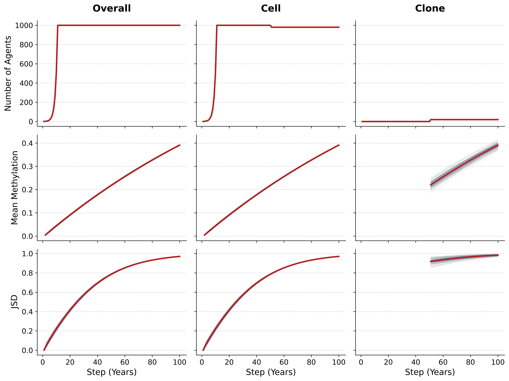
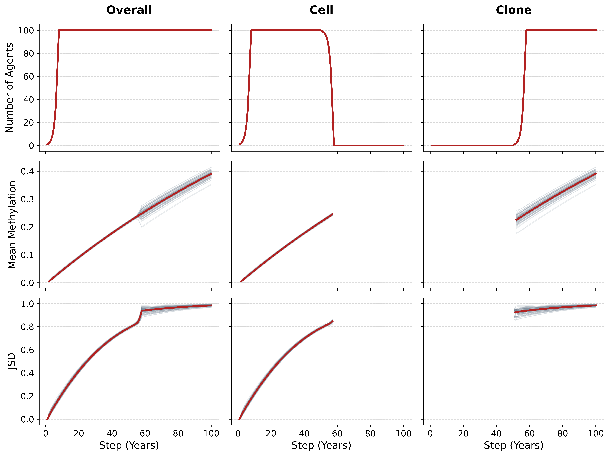
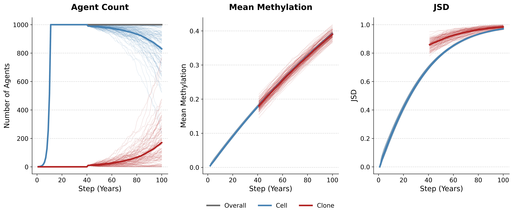
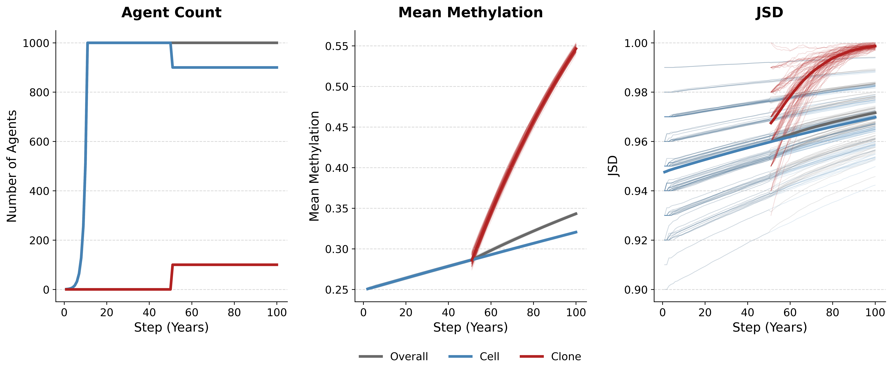

## Agent based model of stochastic methylation during clonal hematopoiesis of indeterminate potential (chip)

**Work-in-progress** experimenting with methylation heterogeneity metrics and ABMs. 

## Simulation Overview

The Agent-Based Model (ABM) simulates the epigenetic drift of a hematopoietic cell population over time, culminating in Clonal Hematopoiesis (CH).

### Agent Structure & Epigenetic Drift

Each `Cell` and `Clone` is mathematically represented as a 2D NumPy array of genes and CpG sites (`n_genes` $\times$ `n_cpgs`). At every simulation step, each CpG site operates under two independent stochastic probabilities:

* `p_meth`: The probability of gaining methylation ($0 \rightarrow 1$).
* `p_unmeth`: The probability of losing methylation ($1 \rightarrow 0$).

These can be single values for every site (the scalar flags) or one value per CpG from a rate profile (see [Per-CpG rates](#per-cpg-rates)). Clones have their own rates (`p_meth_clone`, `p_unmeth_clone`).

### Phases of the Simulation

1. **Developmental Growth:** The model initializes with a single founder `Cell`. This cell duplicates and undergoes methylation drift until the target population size is reached.
2. **Homeostatic Drift:** Once the target size is reached, the population size becomes strictly fixed. Normal `Cells` continue to age and drift stochastically at each step.
3. **CHIP Onset:** At a designated age (`chip_time`), a mutational event is triggered. One or more normal `Cells` are converted into mutant `Clones`.

### Clonal Dynamics & Selection

Following CHIP onset, `Clones` compete with normal `Cells`. Because the population is modeled at a constant capacity, all division is strictly coupled with replacement (a Moran process). Every replacement is drawn uniformly from all agents currently alive, and a newborn is never the one replaced.

* **Turnover (`p_turnover`, default 0):** After the growth phase, every agent (`Cell` or `Clone`) divides with this probability each step, and its daughter replaces a random agent. This neutral turnover gives clonal drift and oligoclonality with age without any driver mutation. Lineages are tracked (`Lineage_Count`, `Largest_Lineage_Fraction`).
* **Duplication (`p_duplicate`):** An extra probability, on top of `p_turnover`, that a `Clone` divides and its daughter replaces a random `Cell` or `Clone`.
* **Death (`p_die`):** A `Clone` dies, and a copy of a randomly selected `Cell` or `Clone` fills the empty niche.
* **Neutral:** The clone does not divide this step. Its probability is $1 - (p_{turnover} + p_{duplicate} + p_{die})$, so the three rates must sum to at most 1.

The evolutionary fitness of the mutant clone is governed by its selective advantage ($s$), relative to normal cells:

$$s = p_{duplicate} - p_{die}$$

If $s > 0$, the clone will expand and outcompete normal cells. If $s = 0$, the clone drifts neutrally, at any `p_turnover`. If $s < 0$, the clone is selected against and will eventually die off.

### Drift coupled to division (`--drift-mode`)

* `time` (default): every agent drifts once per step, as described above.
* `division`: methylation changes only as replication errors when a cell copies its DNA, during the growth phase and at every turnover, duplication or death-replacement event. The rate flags or rate profile are then read as per-division error probabilities. By default both the parent and the daughter receive a round of errors (`--errors-on both`); `--errors-on daughter` applies them to the daughter only.
* `both`: per-step drift with the normal rates plus replication errors with the `*_div` columns of a rate profile.

In `division` mode a cell's drift depends on how often its lineage divides. Normal cells only drift if `p_turnover > 0` (or when copied to replace a dying clone), and a clone's drift depends on $p_{turnover} + p_{duplicate} + p_{die}$, not only on $s$: two clones with the same $s$ can drift at different speeds. Each agent records `n_divisions` and `n_error_rounds`.

### Per-CpG rates

`--rate-profile rates.csv` gives every CpG its own gain, loss and starting-methylation probability, for normal cells and clones separately. The CSV has one row per site, filled into the `n_genes` $\times$ `n_cpgs` array in row-major order, with columns `site_id, p_meth, p_unmeth, init_meth, p_meth_clone, p_unmeth_clone, site_class` and the optional per-division columns `p_meth_div, p_unmeth_div, p_meth_div_clone, p_unmeth_div_clone`. When a profile is given, the scalar rate flags are ignored, with a warning. A profile can be drawn from distributions in a JSON spec (see the docstring of `generate_profile` in `rates.py`):

```
uv run rates.py generate spec.json --seed 1 --n-genes 805 --n-cpgs 1 -o rates.csv
```

Every cell starts as a copy of one founder (`--init-mode founder`), so at the start each site is either methylated in every cell or in none. `--init-mode independent` instead redraws every site of every cell from `init_meth` at the end of the growth phase, which lets a population start at an intermediate bulk methylation.

### Execution & Outputs

By default, the simulation executes 100 independent iterations. Data across all runs is aggregated into a compressed `.csv` file and automatically processed into plots visualizing population dynamics and methylation heterogeneity over time. Runs are reproducible: the same command gives the same output.

Data are recorded at the start of each step, so the row with `Step = k` shows the state after $k - 1$ completed steps (Step 1 is the lone founder). With `--site-beta-out out.npz`, per-site bulk methylation for all agents, Cells and Clones (plus the clone fraction) is saved at the Step labels listed in `--sample-steps` and at the end of the run, under keys such as `run0_step60_all` and `run0_stepfinal_clone_frac`.

### Tests

```
uv run pytest            # fast suite (< 1 minute)
uv run pytest -m slow    # statistical and performance tests
```

Golden outputs in `tests/golden/` pin the default behaviour bit-for-bit. Only regenerate them (`tests/make_golden.py`) for a deliberate change in behaviour.

## Set up and run

Install [uv](https://docs.astral.sh/uv/) then:

```
# Clone the repo
git clone https://github.com/jcalendo/chip-methylation-abm.git
cd chip-methylation-abm

# Sync project dependencies with `uv`
uv sync

# Run simulation script and view arguments
uv run main.py --help
```

## Usage

```
usage: main.py [-h] [--runs RUNS] [--n-proc N_PROC] [--n-agents N_AGENTS] [--steps STEPS]
               [--chip-time CHIP_TIME] [--prop-chip PROP_CHIP] [--n-genes N_GENES]
               [--n-cpgs N_CPGS] [--p-meth P_METH] [--p-unmeth P_UNMETH] [--init-meth INIT_METH]
               [--p-meth-clone P_METH_CLONE] [--p-unmeth-clone P_UNMETH_CLONE]
               [--p-duplicate P_DUPLICATE] [--p-die P_DIE] [--p-turnover P_TURNOVER]
               [--drift-mode {time,division,both}] [--errors-on {both,daughter}]
               [--rate-profile RATE_PROFILE] [--init-mode {founder,independent}]
               [--sample-steps SAMPLE_STEPS] [--site-beta-out SITE_BETA_OUT] [--outfile OUTFILE]
               [--quiet | --no-quiet]

Run the CHIP Methylation Agent-Based Model.

options:
  -h, --help            show this help message and exit
  --runs RUNS           Number of times to repeat the experiment. (default: 100)
  --n-proc N_PROC       Number of processes used for multiprocessing. (default: 4)
  --n-agents N_AGENTS   Total number of cells/agents. Constant population size after growth phase.
                        (default: 1000)
  --steps STEPS         Total number of steps (years) to run the simulation. (default: 100)
  --chip-time CHIP_TIME
                        Step (year) at which the first mutant Clone is introduced. (default: 50)
  --prop-chip PROP_CHIP
                        Proportion of total population that will be turned into Clones at
                        chip_time. (default: 0.02)
  --n-genes N_GENES     Number of genes (rows of CpG matrix) per agent. (default: 100)
  --n-cpgs N_CPGS       Number of CpGs (columns of CpG matrix) per gene. (default: 10)
  --p-meth P_METH       Probability of an unmethylated CpG becoming methylated per step. (default:
                        0.005)
  --p-unmeth P_UNMETH   Probability of a methylated CpG becoming unmethylated per step. (default:
                        1e-06)
  --init-meth INIT_METH
                        Initial proportion of CpGs that are methylated at the start of the
                        simulation. (default: 0.0)
  --p-meth-clone P_METH_CLONE
                        Probability of an unmethylated CpG becoming methylated per step in Clones.
                        (default: 0.005)
  --p-unmeth-clone P_UNMETH_CLONE
                        Probability of a methylated CpG becoming unmethylated per step in Clones.
                        (default: 1e-06)
  --p-duplicate P_DUPLICATE
                        Extra per-step probability (on top of --p-turnover) that a Clone divides
                        and its daughter replaces a random agent. The selective advantage s =
                        p_duplicate - p_die is relative to normal cells. (default: 0.0)
  --p-die P_DIE         Per-step probability that a Clone dies and is replaced by a copy of a
                        random agent (Cell or Clone). (default: 0.0)
  --p-turnover P_TURNOVER
                        Per-step probability that each agent (Cell or Clone) divides after the
                        growth phase, its daughter replacing a random agent (neutral Moran
                        turnover). p_turnover + p_duplicate + p_die must be <= 1. (default: 0.0)
  --drift-mode {time,division,both}
                        'time': every agent drifts once per step. 'division': methylation changes
                        only as replication errors when a cell divides, and the rate flags/profile
                        are per-division error probabilities. 'both': per-step drift plus
                        replication errors with the *_div columns of the rate profile. (default:
                        time)
  --errors-on {both,daughter}
                        Which copies get replication errors at a division: parent and daughter, or
                        the daughter only. (default: both)
  --rate-profile RATE_PROFILE
                        CSV of per-CpG rates (one row per site, see rates.py). Overrides the
                        scalar rate flags (--p-meth, --p-unmeth, --init-meth, --p-meth-clone,
                        --p-unmeth-clone).
  --init-mode {founder,independent}
                        'founder': every cell copies the founder's initial pattern. 'independent':
                        at the end of growth every cell redraws each site from init_meth.
                        (default: founder)
  --sample-steps SAMPLE_STEPS
                        Comma-separated Step labels at which to save per-site bulk beta (requires
                        --site-beta-out). The final state is always saved as step 'final'.
                        (default: ())
  --site-beta-out SITE_BETA_OUT
                        Path of a .npz file for per-site bulk beta snapshots.
  --outfile OUTFILE     Filename to save run results DataFrame to. (default: run_results.csv.gz)
  --quiet, --no-quiet   Do not print program messages. (default: False)
```

## Examples

The current simulation has a lot of arguments to tweak. It's not immediately evident how adjusting these parameters leads to different behaviors. So I'll try to list a few examples to give an idea of what is currently possible.

### Simulating a constant 2% Clonal population size starting at CH onset

2% of Cells are removed at onset of CH and are replaced by exact copies of a selected Clone. These Clones persist until the end of the simulation. Their methylation still drifts but the composition of the population never changes. `--n-proc 12` & `--runs 100` indicates that we will repeat this experiment using the same parameters with different random numbers generator seeds 100 times using 12 parallel processes. 

```{bash}
uv run main.py --prop-chip 0.02 --p-duplicate 0.0 --p-die 0.0 --n-proc 12 --runs 100
```



> The plots for the next two examples were made before replacement was changed to always draw from the current population (never the newborn). Rerunning them gives slightly different numbers.

### Simulating a single Clone at CH onset with exponential Clonal growth

Setting `--prop-chip` to a value that results in a fractional number of Clones at onset will default to a single clone (e.g. 100 agents * 0.001 = 0.1 -> 1 Clone at onset). Once the Clone is initialized it will divide according to its selective advantage. Setting `--p-duplicate 1.0` and `p-die 0.0` ensures that every Clone will always divide into two Clones in the next step (i.e. exponential growth).

```{bash}
uv run main.py --n-agents 100 --prop-chip 1e-6 --p-duplicate 1.0 --p-die 0.0
```



### Simulating 1% Clones at age 40 with a strong selection advantage over Cells

The selection advantage (s) is given by `p_duplicate - p_die`. As stated above, if this value is positive then Clones have a fitness advantage over Cells. There are an infinite number of ways to tune these values to achieve the same value for `s`.

```{bash}
uv run main.py --chip-time 40 --prop-chip 0.01 --p-duplicate 0.25 --p-die 0.2
```



### Simulating different methylation drift/maintenance rates for Cells and Clones

The random chance of methylating or unmethylating a given CpG can be controlled for Cells and Clones independently. The initial methylation state of the founder Cell can also be set to simulate a founder Cell with a proportion methylation != 0.0.

```{bash}
uv run main.py \
  --init-meth 0.25 \
  --prop-chip 0.1 \
  --p-meth 0.001 \
  --p-unmeth 1e-6 \
  --p-meth-clone 0.01 \
  --p-unmeth-clone 0.001
```



### Neutral turnover of normal cells

Every agent divides with probability 0.3 per year after development. Without any driver, lineages are lost over time and the population becomes oligoclonal (see `Lineage_Count` in the output CSV).

```{bash}
uv run main.py --prop-chip 0.0 --p-turnover 0.3
```

### Drift coupled to cell division

Methylation errors happen only when DNA is copied. Here `--p-meth` is a per-division error probability, and a clone with a 5% advantage over normal cells divides more often and so drifts faster.

```{bash}
uv run main.py --drift-mode division --p-turnover 0.2 --p-meth 0.01 --p-meth-clone 0.01 \
  --chip-time 40 --prop-chip 0.01 --p-duplicate 0.05
```

### Per-CpG rates with per-site output

```{bash}
uv run rates.py generate spec.json --seed 1 --n-genes 805 --n-cpgs 1 -o rates.csv
uv run main.py --rate-profile rates.csv --n-genes 805 --n-cpgs 1 --init-mode independent \
  --sample-steps 40,80 --site-beta-out site_beta.npz
```
